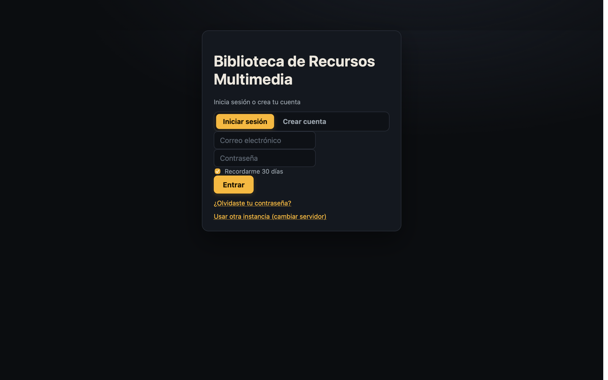
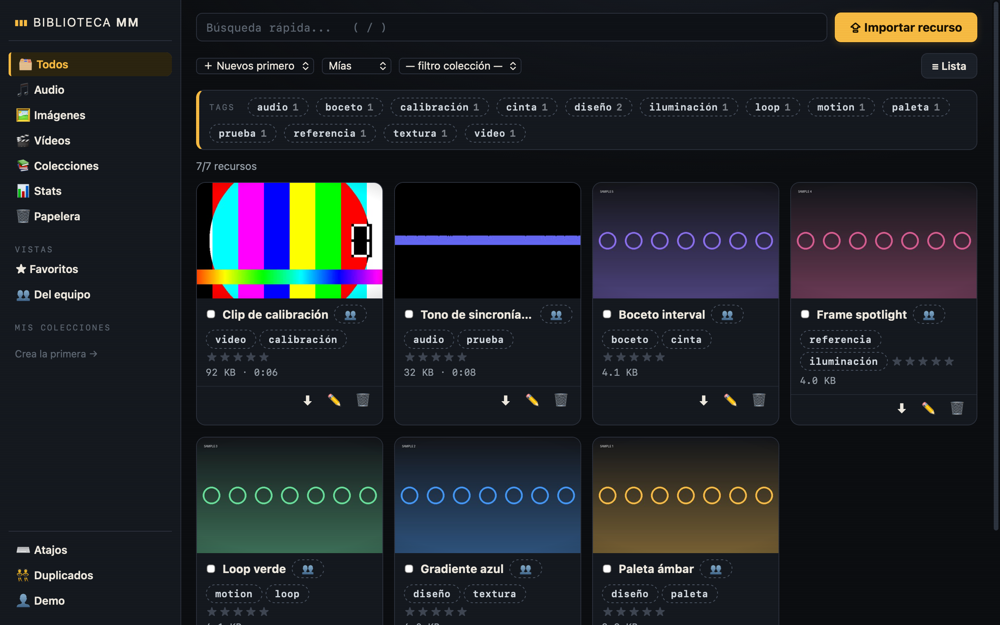

# Biblioteca de Recursos Multimedia

Proyecto generado con el scaffolding **FastAPI + Tauri** (Windows / macOS / Linux).

- **Backend**: FastAPI + SQLite, para **Python 3.14+**, gestionado con **uv**
  - Cuentas de usuarios: registro / login con JWT + bcrypt
  - Recuperación de contraseña: código de 6 dígitos por correo, un solo uso
  - Correos: servicio SMTP (con correo de bienvenida al registrarse; sin SMTP solo loguea por consola)
  - Migraciones con **Alembic** (auto al arrancar + autogenerado)
  - **pytest** con test de humo y **Ruff** (lint + formato) preconfigurados
- **Frontend**: Tauri 2 + React + Vite (multiplataforma: Windows / macOS / Linux)
  - Íconos generados para las 3 plataformas (`icon.ico`/`icon.icns`/PNGs)
  - CSP activada en producción y dev (con HMR de Vite permitido)
  - Tests de UI con **vitest** (`pnpm test`)
- **CI**: GitHub Actions (`.github/workflows/ci.yml`) — backend, frontend e imagen Docker en cada PR/push; compilados nativos multiplataforma (Windows/macOS/Linux + instaladores como artifacts) solo con un tag `v*` o ejecución manual por `Actions → Run workflow`
- **Docker**: `docker-compose.yml` para desplegar la API (FastAPI + SQLite) con un ejecutable persistente

## Capturas

| Login con tu primera entrada | Biblioteca |
| --- | --- |
|  |  |

> **Login**: abajo del card hay un enlace *“Usar otra instancia (cambiar servidor)”*
> que despliega 🌐 la dirección del backend. Cualquier instalación (DMG, .msi o
> APK) puede apuntar a **su propia instancia** sin recompilar.
> **Biblioteca**: tags sugeridos, rating, visibilidad (privada / del equipo),
> colecciones, stats y papelera.

## Backup de tus datos

`backend/uploads/` y `backend/app.db` NO viven en git (son tus ficheros). Respáldalos con:

```bash
powershell -File scripts/backup.ps1            # Windows
bash scripts/backup.sh /ruta/destino           # macOS/Linux
```

Se crea `backups/biblioteca-backup-<fecha>.zip` (stageo primero → compatible con la BD abierta del server). El script imprime el comando sugerido para programarlo a diario con `schtasks`/cron.
- **Git**: repositorio inicializado con el primer commit
- **Graphify**: listo para mapear el proyecto (ver más abajo)
- **Licencia**: MIT (`LICENSE`) — cámbiala si tu proyecto lo requiere

## Estructura

```
Biblioteca de Recursos Multimedia/
├── backend/               # FastAPI + SQLite
│   ├── app/
│   │   ├── main.py        # Punto de entrada (aplica migraciones al arrancar)
│   │   ├── config.py      # Configuración (.env)
│   │   ├── database.py    # Conexión SQLite
│   │   ├── models.py      # Modelo User
│   │   ├── schemas.py     # Esquemas Pydantic
│   │   ├── security.py    # Bcrypt + JWT
│   │   ├── deps.py        # Dependencias (usuario actual, sesión BD)
│   │   ├── routers/       # /health, /auth, /users, /media, /collections
│   │   └── services/      # email.py (SMTP), media.py (uploads + ffmpeg + Pillow)
│   ├── alembic/           # Migraciones de la BD
│   │   └── versions/      # 0001, 0002… las nuevas que generes
│   ├── tests/             # Tests (pytest) — test de humo incluido
│   ├── alembic.ini
│   ├── pyproject.toml     # Dependencias + config de ruff y pytest (fuente de verdad)
│   ├── Dockerfile         # Imagen de la API para producción
│   ├── .env               # Variables de entorno (no se sube a git)
│   └── requirements.txt   # Respaldo pip (opcional)
├── frontend/              # Tauri 2 + React + Vite
│   ├── src/               # UI de la app (login/registro/recuperación)
│   └── src-tauri/         # Shell nativo (Rust)
├── .github/workflows/     # CI (ruff+pytest, vitest+build, docker, native builds)
├── deploy/                # Pi/servidor: compose (API+web+Caddy HTTPS), deploy.sh
├── docker-compose.yml     # API en Docker con BD persistente (solo backend)
├── render.sh              # convierte esta copia en un proyecto nuevo
├── scripts/               # ayuda: firma de APK Android, build Docker, etc.
├── LICENSE                # MIT
├── run.ps1                # Backend + frontend (Windows)
├── run.sh                 # Backend + frontend (macOS / Linux)
└── README.md
```

## Requisitos previos

- Python 3.14+ (probado en 3.14.7) y [`uv`](https://docs.astral.sh/uv/getting-started/installation/) como gestor de paquetes
- Node.js 18+ (y [`pnpm`](https://pnpm.io/installation) como gestor de paquetes)
- Rust (para compilar Tauri): https://rustup.rs
- Windows: Microsoft Visual Studio Build Tools (componente C++)
- macOS: Xcode Command Line Tools — ejecuta `xcode-select --install`
- Linux: dependencias del sistema según tu distro
  (ver https://tauri.app/start/prerequisites/)

## Renderizar para un proyecto nuevo

Este proyecto funciona como template. Para crear un proyecto con él:

```bash
# 1. Copia el proyecto a una carpeta nueva (sin node_modules/.venv/target/gen)
# 2. Dentro de la copia:
bash render.sh          # pregunta nombre, slug e identificador
```

El script: reemplaza **todos** los marcadores/nombres del proyecto anterior,
genera una `SECRET_KEY` nueva para el backend, crea `backend/.env` si falta y
verifica que no queden `{{...}}` sin renderizar. Sigue los "Siguientes pasos"
que imprime (nueva historia git, sincronización de dependencias, keystore Android
nuevo si vas a compilar APK firmada; **no** recicle de este template la keystore).

## Puesta en marcha

### 1. Un solo comando (recomendado)

| SO | Comando |
|----|---------|
| Windows | `powershell -File run.ps1` |
| macOS / Linux | `bash run.sh` |

### 2. Manual

#### Backend (API en http://localhost:8000)

```bash
cd backend
uv sync                            # crea .venv e instala todo (genera uv.lock)
uv run uvicorn app.main:app --reload
```

La documentación interactiva queda en **http://localhost:8000/docs**.

##### Base de datos (Alembic)

El backend **aplica migraciones automáticamente al arrancar**.
Cuando cambies un modelo (`app/models.py`), genera la migración nueva:

```bash
uv run alembic revision --autogenerate -m "descripcion_del_cambio"
# al reiniciar uvicorn la aplica; o manualmente: uv run alembic upgrade head
```

##### Calidad de código

```bash
uv run pytest                 # test de humo + rate limiting: registro → login → perfil + recuperación
uv run ruff check . --fix     # lint
uv run ruff format .          # formato automático
```

##### Seguridad

- **Rate limiting por IP** en `/auth/register`, `/auth/login`, `/auth/forgot-password`
  y `/auth/reset-password` (429 + `Retry-After`). Defaults: login 10/min, registro
  y recuperación 5/min. Configurables en `backend/.env` (`RATE_LIMIT_*`).
- **CORS por entorno**: `CORS_ORIGINS` en `backend/.env` (lista exacta)
  y `CORS_ORIGIN_REGEX` para cubrir varias páginas/subdominios del proyecto
  **sin listarlas una por una** (ej. `CORS_ORIGIN_REGEX=https://.*\.l20j45\.us(:\d+)?`).
  **Importante:** CORS es sobre el *origen de la página* que corre en un navegador —
  las **IPs de los clientes/dispositivos que llaman a la API NO van aquí**
  (cambiar de IP no rompe nada), y a las apps nativas (Tauri/APK) ni les aplica.
  Solo lista el dominio de cada página web que consume la API, o usa el regex
  para subdominios de tu zona. Coherente con `VITE_API_URL` del `.env` raíz.

##### Recuperación de contraseña (opcional SMTP o consola)

1. En el login: **¿Olvidaste tu contraseña?** → escribe tu correo.
2. Llega un código de 6 dígitos (a tu bandeja o, sin SMTP, al log del backend).
3. Escribe el código y la contraseña nueva; expira en 30 minutos y se usa una sola vez.

#### Frontend (ventana multiplataforma)

```bash
cd frontend
pnpm install
pnpm run tauri dev
```

La primera compilación de Rust tarda unos minutos. Para empaquetar instaladores: `pnpm run tauri build`
(en macOS genera `MyApp.app` + `.dmg`; en Windows `.msi`/`.exe`; en Linux `.deb`/`.AppImage`).

#### Cambiar de backend sin recompilar (instancia propia)

El backend que la app trae compilado (`VITE_API_URL`) es solo el **default**.
En el login (o en el perfil de HomePage) puedes apuntar a otra instancia:

1. Login → **“Usar otra instancia (cambiar servidor)”** → escribe la URL
   (ej. `http://192.168.1.10:8000` o `https://api.midominio.com`).
2. Pulsa *Entrar*: la dirección se valida y se guarda **antes** de enviar credenciales.
3. Se guarda por dispositivo (`localStorage`, clave `api_base`); dejando el
   campo vacío vuelve al backend compilado. También puedes cambiarla después
   desde el perfil en HomePage.

### 3. Correos (SMTP)

Edita `backend/.env` con tus datos SMTP (Gmail: host `smtp.gmail.com`, port `465`, usar *contraseña de aplicación*).
Sin SMTP configurado, la app funciona normal y los correos (bienvenida, código de recuperación) se registran por consola.

### 4. API en producción (Docker)

Para el bundle completo self-hosted (API pública en su puerto + página web con
nginx, TLS vía Cloudflare), usa la carpeta **`deploy/`** — ver
[`deploy/README.md`](deploy/README.md):

```bash
cp deploy/.env.example deploy/.env               # IMAGE_TAG, API_PORT
cp deploy/backend.env.example deploy/backend.env # SECRET_KEY, CORS, SMTP
bash deploy/deploy.sh pi@raspberrypi.local       # build web + rsync + up
```

La web también se puede publicar aparte (es estática):
`cd frontend && pnpm run build` → sube `frontend/dist/` donde quieras
(Cloudflare Pages, S3, etc.), apuntando `VITE_API_URL` a tu API.

```bash
bash scripts/build-docker.sh   # construye la imagen con el nombre del .env raíz
docker compose up              # desde la raíz; BD persistente en un volumen
```

El nombre de la imagen (`${PROJECT_SLUG}-api`) y el puerto publicado
(`$API_PORT:8000`) se leen del **`.env` raíz** — nada hardcodeado. Si no
existe alguna de las variables usa los defaults (`biblioteca-recursos-multimedia`, `8000`).

La imagen de Docker **solo compila la API** (FastAPI + SQLite, puerto 8000).
Ideal si algún día quieres exponer el backend sin la app de escritorio.

#### Deploy en Raspberry Pi

Todo lo de abajo vale para Raspberry Pi OS **64 bits y DietPi 64 bits** —
ambos son `linux/arm64` y la imagen base (`uv:python3.14-bookworm-slim`)
lo publica (verificado: `amd64, arm64`).

El motor de contenedores y la plataforma también vienen del `.env` raíz
(`CONTAINER_ENGINE`, `TARGET_PLATFORM`):

```bash
bash scripts/build-docker.sh --dry-run          # prueba sin construir

# A) Build local para la Pi (SO de 64 bits), luego transferes:
TARGET_PLATFORM=linux/arm64 bash scripts/build-docker.sh
podman save ${PROJECT_SLUG}-api:latest | gzip > api.tar.gz
scp api.tar.gz pi@raspberrypi.local:
# en la Pi:  gunzip -c api.tar.gz | docker load

# B) (Recomendado, más simple) construir directamente en la Pi:
rsync -av --exclude node_modules --exclude .venv --exclude 'src-tauri/target' \
      --exclude graphify-out . pi@raspberrypi.local:~/app/
ssh pi@raspberrypi.local
cd ~/app && docker compose up -d --build
```

Checklist en la Pi: `backend/.env` (gitignoreado — copialo a mano),
`SECRET_KEY` distinta del dev, CORS_ORIGINS con el dominio real o la IP de la
Pi, y `VITE_API_URL` apuntando a la Pi **antes de recompilar** web/APK de la
aplicación.

### 5. APK de Android (release firmada)

```bash
cd frontend
pnpm tauri android init              # una vez por proyecto
bash scripts/setup-android-signing.sh   # aplica la firma release (idempotente)
pnpm tauri android build --apk
```

La APK firmada queda en
`src-tauri/gen/android/app/build/outputs/apk/universal/release/app-universal-release.apk`.

- La **firma** se lee del `.env` raíz (`TAURI_ANDROID_KEYSTORE_PATH`, `_PASSWORD`,
  `TAURI_ANDROID_KEY_ALIAS`, `_KEY_PASSWORD`); sin esas variables compila sin
  firmar sin romper nada. El script de signing vuelve a parchear gradle porque
  `src-tauri/gen/` no se sube a git.
- `VITE_API_URL` (también del `.env` raíz) es la dirección del backend con la
  que la APK lleva compilada el default... aunque la app permite cambiar el
  servidor en runtime (login o perfil), así que es a título de default inicial.
- Mientras el backend sea HTTP, `app/build.gradle.kts` usa cleartext; si pasa a
  HTTPS, pon `usesCleartextTraffic` en `false`.

## Variables globales raíz (`.env`)

Para juntar la configuración compartida se usa un `.env` en la raíz del
proyecto (no se sube a git; copia `.env.example` para empezar):

| Variable                        | Qué controla                                                                 |
|---------------------------------|------------------------------------------------------------------------------|
| `PROJECT_NAME` / `PROJECT_SLUG` | Nombre de la app y slug para paquetes/imagen Docker                           |
| `VITE_API_URL`                  | Dirección **default** del backend al compilar (Vite). La app permite cambiarla **en runtime** desde el login/perfil (localStorage `api_base`), así que solo es el arranque inicial, no algo fijo |
| `TAURI_ANDROID_KEYSTORE_PATH` / `..._PASSWORD` / `..._ALIAS` / `..._KEY_PASSWORD` | Firma automática de la APK de release (leído por `gen/android/app/build.gradle.kts`) |
| `API_PORT`                      | Puerto del despliegue Docker del backend                                      |

## Instaladores y versiones

- **Windows (.msi / .exe)** — se generan en GitHub Actions con
  `.github/workflows/release.yml`: al pushear un tag `v*` (ej. `git tag v0.10 &&
  git push origin v0.10`) tauri-action crea un GitHub Release con los
  instaladores adjuntos.
- **macOS (.app/.dmg)** — `pnpm run tauri build` en una Mac (los binarios son
  por arquitectura: `aarch64` para Apple Silicon).
- **Android (.apk firmada)** — sección 5 más arriba.
- **Docker (backend, arm64 nativo)** — `scripts/build-docker.sh` + `docker compose up`;
  el `tar.gz` para la Pi sale con `podman save ... | gzip`.

## Graphify

Este proyecto está pensado para usarse con **Graphify** (OpenCode): invoca la skill
`graphify` en la raíz del proyecto para generar un grafo de conocimiento del código
en `graphify-out/`. Esa carpeta está en `.gitignore`.

**Kit pre-trenzado (`ai-kit/`)**: el repo commitea el grafo + el caché de extracción,
así que en cada clon nuevo basta correr el skill `ai-bootstrap`: restaura el estado
y solo re-extracta lo que cambió (≈0 tokens LLM). El MCP de graphify ya viene
configurado en `opencode.json` (servidor local por `uv`, sirve `graph.json`).

Con el hook instalado (`graphify hook install`), el grafo se **reconstruye solo
en cada `git commit`** (re-extrae únicamente los archivos cambiados), así está
siempre al día. Los cambios solo de docs no dispara el hook: en ese caso corre
`/graphify --update` a mano.

## Íconos de la app

Se generan automáticamente para las 3 plataformas (`icon.ico`, `icon.icns`, PNGs).
Para usar tu propio logo: `pnpm run tauri icon ruta/mi-logo-1024.png` y listo
(regenera todos los formatos).

## Roles: super admin, registro y equipos

- **Super admin**: el **primer usuario registrado** queda automáticamente como
  super admin (`users.is_admin`). En instalaciones previas a esta función, la
  migración `0009` promovió al usuario más antiguo.
- Desde el sidebar (sección **Gestión**) el admin puede:
  - **🛡 Administración**: ver TODOS los usuarios (total / activos),
    activar/desactivar cuentas, promover o retirar admins (con guardas:
    no puede desactivarse a sí mismo ni dejar la instalación sin admin) y
    **abrir/cerrar el registro** de cuentas nuevas (instancia "solo por
    invitación"). Con el registro cerrado, la pantalla de login oculta el
    tab «Crear cuenta» y la API responde 403 en `/auth/register`.
  - **👥 Equipos**: crear equipos, invitar por correo a usuarios YA
    registrados, quitar miembros, salir o disolver equipos.
- **Visibilidad por equipo**: al subir/editar un recurso puedes dejarlo
  *Privado* (solo tú), *Del equipo → Todos mis equipos* (lo ven los miembros
  de los equipos en que estás) o *Del equipo → Solo: N* (lo ven únicamente
  los miembros de ese equipo concreto). Fuera del estado de admin, esto
  comparte SOLO lectura: nadie más puede editar o borrar tus recursos.

## Rate limiting

Los endpoints sensibles están limitados por IP (ventana de 60 s, config en
`backend/.env` con `RATE_LIMIT_*`): login 10/min, registro y recuperación
5/min, `/admin` 30/min y `/teams` 60/min.

## Endpoints principales

| método | Ruta                  | Descripción                                             |
|--------|-----------------------|---------------------------------------------------------|
| GET    | /health               | Estado de la API                                        |
| GET    | /auth/registration    | ¿Registro abierto? (público; la UI adapta su tab)       |
| POST   | /auth/register        | Crear cuenta (el PRIMER usuario queda como super admin) |
| POST   | /auth/login           | Login → token JWT                                       |
| GET    | /auth/me              | Perfil del usuario autenticado                          |
| POST   | /auth/forgot-password | Pide el código de recuperación (respuesta 204 neutra)   |
| POST   | /auth/reset-password  | Cambia la contraseña con el código de 6 dígitos         |
| PATCH  | /users/me             | Actualizar nombre / contraseña                          |
| GET    | /admin/overview       | (admin) usuarios + conteos + estado del registro        |
| PATCH  | /admin/users/{id}     | (admin) activar/desactivar, promover/retirar admin      |
| PUT    | /admin/registration   | (admin) cerrar/abrir el registro                        |
| GET/POST | /teams              | Equipos del usuario / crear equipo                      |
| GET    | /teams/{id}           | Miembros del equipo (y sus roles)                       |
| POST   | /teams/{id}/members   | Invitar por correo (requiere dueño del equipo)          |
| DELETE | /teams/{id}/leave     | Salir del equipo                                        |
| DELETE | /teams/{id}/members/{uid} | Quitar miembro                                     |
| DELETE | /teams/{id}           | Disolver el equipo                                      |

Backups y migraciones (incluye roles y equipos, que viven en la BD):
`docs/db-migraciones-y-backups.md`

© 2026 — Biblioteca de Recursos Multimedia
